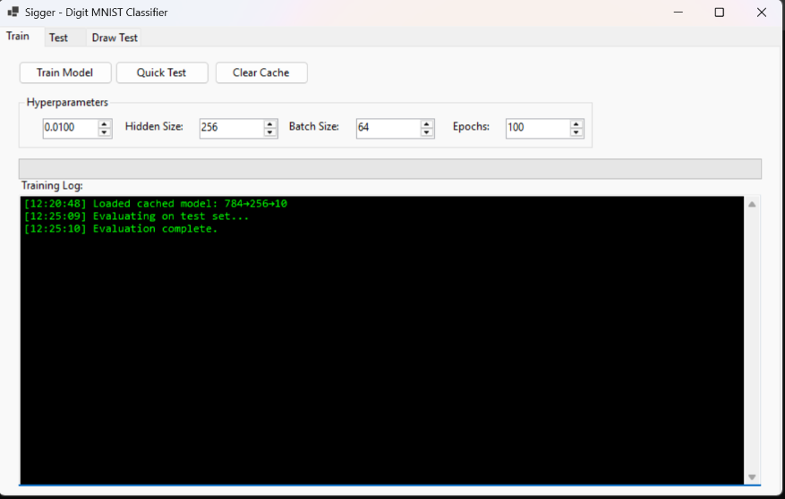
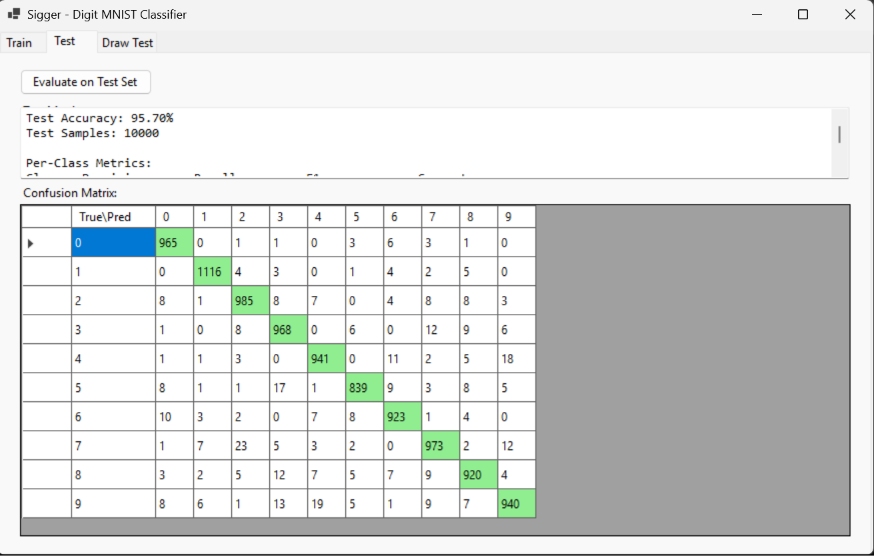
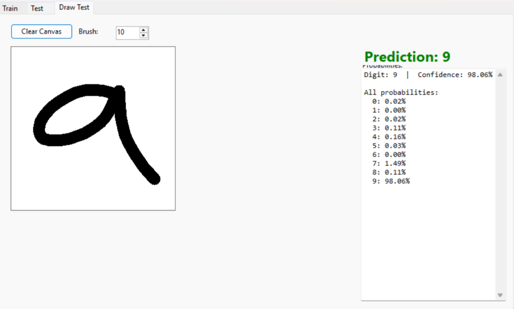

# Sigger - Digit MNIST Classifier

A C# Windows Forms application for training and testing a custom Multi-Layer Perceptron (MLP) on the Digit MNIST dataset. Features SIMD-accelerated matrix operations, multi-threaded training, model caching, and an interactive drawing canvas for real-time digit recognition.

## Features

- **Custom MLP Implementation**: 3-layer neural network (Input → Hidden → Output) with backpropagation from scratch
- **SIMD & Multi-threading**: AVX2-accelerated matrix operations with parallel processing
- **Digit MNIST Support**: 28×28 grayscale images, 10 classes (digits 0-9)
- **Training UI**: Configurable hyperparameters (learning rate, hidden size, batch size, epochs) with live loss/validation plots
- **Model Caching**: Automatic JSON serialization with per-epoch checkpoint capability
- **Test Evaluation**: Full test set evaluation with confusion matrix and per-class metrics (Precision, Recall, F1)
- **Draw Test Canvas**: 280×280 interactive drawing area (10× scale) for real-time digit prediction
- **CLI Mode**: Headless training/testing for automation and CI/CD

## Project Structure

```
Sigger/
├── Sigger.csproj              # Project file
├── Program.cs                 # Entry point (GUI + CLI)
├── Form1.cs                   # Main form logic
├── Form1.Designer.cs          # Windows Forms designer code
├── README.md                  # This file
├── data/
│   ├── README.md              # Dataset info
│   ├── mnist_train.csv        # Training data (60,000 samples)
│   ├── mnist_test.csv         # Test data (10,000 samples)
│   └── DataLoader.cs          # CSV loading, normalization, train/val split
├── NeuralNetwork/
│   ├── MLP.cs                 # Multi-Layer Perceptron core
│   ├── Layers/
│   │   ├── ILayer.cs          # Layer interface
│   │   ├── DenseLayer.cs      # Fully connected layer
│   │   └── ActivationLayer.cs # Activation wrapper
│   ├── Activations/
│   │   ├── IActivation.cs     # Activation interface
│   │   ├── ReLU.cs            # ReLU activation
│   │   └── Softmax.cs         # Softmax activation
│   └── Loss/
│       ├── ILoss.cs           # Loss interface
│       └── CrossEntropyLoss.cs # Cross-entropy loss
├── Math/
│   └── Matrix.cs              # SIMD/parallel matrix operations
└── Camera/                    # Legacy camera module (not used for MNIST)
```

## Requirements

- .NET 8.0 SDK
- Windows (for Windows Forms GUI)
- CPU with AVX2 support (for optimal performance)

## Installation

```bash
git clone <repo-url>
cd Sigger
dotnet restore
dotnet build
```

## Usage

### GUI Mode (Default)
```bash
dotnet run
```
Or simply run the built executable.

### CLI Mode
```bash
# Train and evaluate
dotnet run -- --train --test

# Train only (saves model_cache.json)
dotnet run -- --train

# Evaluate cached model
dotnet run -- --test

# Run matrix benchmark
dotnet run -- --bench

# Force GUI even with args
dotnet run -- --gui
```

### CLI Arguments
| Argument | Description |
|----------|-------------|
| `--train` | Train a new model |
| `--test` | Evaluate on test set |
| `--bench` | Run matrix multiplication benchmark |
| `--gui` | Force GUI mode |
| `--epochs N` | Number of training epochs (default: 100) |
| `--lr N` | Learning rate (default: 0.01) |
| `--batch N` | Batch size (default: 64) |
| `--hidden N` | Hidden layer size (default: 256) |

## Architecture

### Neural Network
- **Input Layer**: 784 neurons (28×28 flattened pixels)
- **Hidden Layer**: Configurable (default 256) with ReLU activation
- **Output Layer**: 10 neurons (digits 0-9) with Softmax activation
- **Loss**: Cross-entropy (combined with Softmax for efficient gradient)
- **Optimizer**: SGD with configurable learning rate

### Data Pipeline
1. Load CSV (label + 784 pixels)
2. Normalize pixels to [0, 1]
3. One-hot encode labels (10 classes)
4. Shuffle and split: 90% train / 10% validation
5. Test set kept separate (10,000 samples)

### Matrix Operations (Math/Matrix.cs)
- Row-major `double[,]` layout for cache efficiency
- AVX2 SIMD via `System.Runtime.Intrinsics.X86.Avx2`
- Parallel.For with optimal chunk sizing
- Pre-computed transposes to avoid repeated allocation
- In-place operations to minimize GC pressure

### Model Persistence
- JSON serialization of all weights and biases
- Stored as flat arrays with shape metadata
- Loaded on startup if `model_cache.json` exists

## UI Tabs

### Train Tab

- **Hyperparameters**: Learning rate, hidden size, batch size, epochs
- **Train Button**: Starts background training with live log
- **Quick Test**: Fast validation accuracy check
- **Clear Cache**: Deletes `model_cache.json`

### Test Tab

- **Evaluate on Test Set**: Full evaluation with metrics
- **Confusion Matrix**: Interactive grid with diagonal highlighting
- **Per-Class Metrics**: Precision, Recall, F1, Support
- **Macro Averages**: Overall performance summary

### Draw Test Tab

- **280×280 Canvas**: Draw digits with mouse (black on white, default brush radius 12px ≈ 2.4px at 28×28)
- **Clear Canvas**: Reset drawing
- **Real-time Prediction**: Shows predicted digit + confidence
- **All Probabilities**: Lists probability for each digit 0-9

## Training Tips

| Parameter | Recommended Range | Notes |
|-----------|------------------|-------|
| Learning Rate | 0.001 - 0.1 | Lower = more stable, higher = faster |
| Hidden Size | 128 - 512 | Larger = more capacity, slower |
| Batch Size | 32 - 256 | Larger = better GPU utilization |
| Epochs | 20 - 100 | Early stopping prevents overfitting |

Typical good configuration: LR=0.01, Hidden=256, Batch=64, Epochs=50-100

## Hyperparameter Tuning Results

Systematic experiments were run with 5 configurations (50 epochs each, Batch=64) to identify optimal settings. Results logged in `results/` as JSON.

| LR | Hidden | Batch | Epochs | Val Acc | Test Acc | Training Time | Notes |
|----|--------|-------|--------|---------|----------|---------------|-------|
| 0.001 | 256 | 64 | 50 | 88.7% | 89.0% | 1138s | Slow convergence, underfits |
| 0.01 | 128 | 64 | 50 | 93.9% | 93.9% | 835s | Underfitting (hidden too small) |
| **0.01** | **256** | **64** | **50** | **94.3%** | **94.2%** | **1102s** | **Good baseline** |
| 0.01 | 512 | 64 | 50 | 94.4% | 94.6% | 1463s | Diminishing returns, 33% slower |
| **0.1** | **256** | **64** | **50** | **97.5%** | **97.8%** | **1125s** | **Best — stable, fast convergence** |

**Key Findings:**
- **LR=0.1 with Hidden=256 achieves 97.8% test accuracy** — the highest among tested configs
- LR=0.001 converges too slowly (loss still dropping at epoch 50)
- Hidden=128 underfits; Hidden=512 gives marginal gain over 256 at 33% time cost
- LR=0.1 is stable for this architecture (no divergence observed)

**Run your own sweep:**
```bash
# Config 1: Slow convergence baseline
dotnet run -- --train --test --lr 0.001 --hidden 256 --batch 64 --epochs 50

# Config 2: Underfitting (small hidden)
dotnet run -- --train --test --lr 0.01 --hidden 128 --batch 64 --epochs 50

# Config 3: Good baseline
dotnet run -- --train --test --lr 0.01 --hidden 256 --batch 64 --epochs 50

# Config 4: Diminishing returns (large hidden)
dotnet run -- --train --test --lr 0.01 --hidden 512 --batch 64 --epochs 50

# Config 5: Best result
dotnet run -- --train --test --lr 0.1 --hidden 256 --batch 64 --epochs 50
```

Results saved to `results/{LR}_{HIDDEN}_{BATCH}_{EPOCHS}_TRAIN.json` for analysis.

## Performance

On a modern CPU with AVX2:
- Matrix multiply: 5-10 GFLOPS
- Training epoch (60k samples): ~5-15 seconds
- Inference (single sample): <1ms
- Test accuracy: ~97-98% achievable

## License

MIT License - Educational project for CS345 Intelligent Systems

## Credits

- MNIST dataset: Yann LeCun, Corinna Cortes, Christopher Burges
- CSV format: Joseph Redmon (pjreddie.com)
- Inspired by Sign Language MNIST project